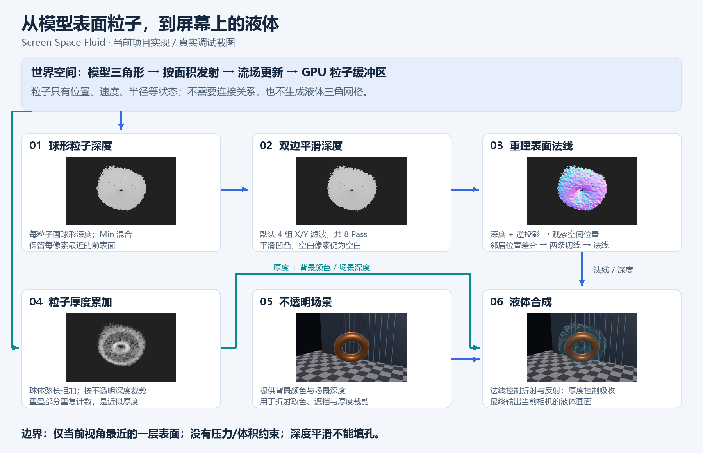
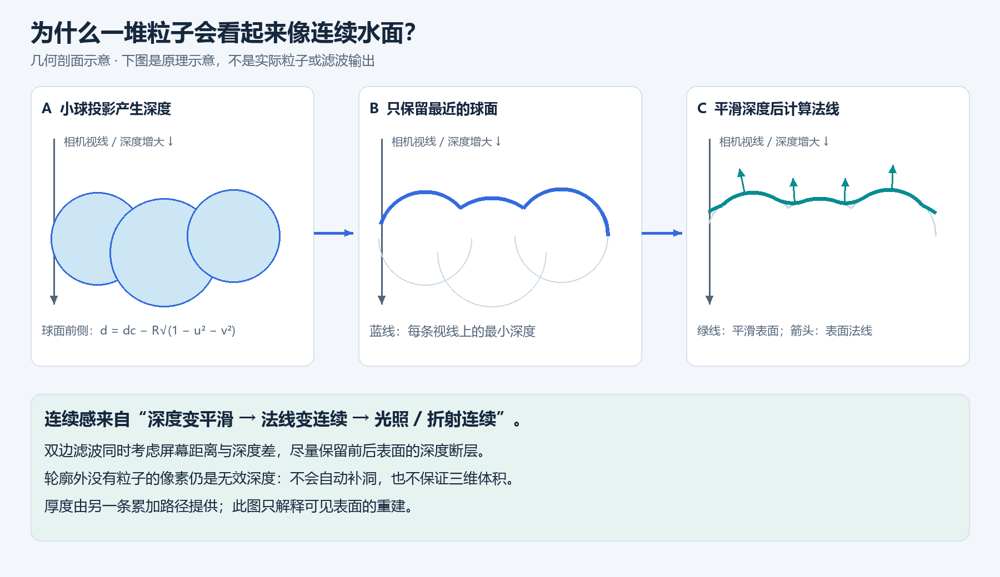

# 从模型表面粒子重建液体：Screen Space Fluid 技术说明

本文对应本仓库 `Assets/ScreenSpaceFluid/` 与 `Assets/SurfaceDustGpu/` 的当前实现，面向需要理解、调试或扩展该效果的 Unity 渲染开发者。代码核对日期：2026-10-28。

## 1. 重建的究竟是什么

本例把从模型表面发射的三维粒子，重建成**当前相机可见的连续深度与法线**。它不连接粒子、不生成液体 Mesh，也不提取三维等值面。每帧的输入是 GPU 粒子缓冲区，输出是已经合成液体的相机颜色。

“屏幕空间”限定的是表面重建和着色阶段。粒子的发射、位置、速度和运动仍然在三维世界空间计算。当前运动采用解析流场与阻尼，没有 SPH/PBF 压力求解、不可压缩约束、表面张力或实体碰撞。液体外观不代表运动已经满足流体物理。



图 1：上方是三维粒子模拟，下方是相机内的渲染。截图来自项目已有的 `Assets/ScreenSpaceFluid/Preview/`，不是本次重新运行 Unity 后生成的结果。厚度和深度从同一份粒子状态独立绘制；法线直接在合成 Pass 内计算，并没有单独的法线 RenderTexture。图中不透明场景也向厚度阶段提供裁剪深度。

## 2. 为什么粒子能呈现连续表面



图 2 是几何剖面示意，不是实际滤波输出。每条相机视线先选取最近的球面，形成带凹凸的深度包络。随后平滑深度，让相邻像素恢复出的法线更连续。折射与反射由这组法线驱动，因此视觉上出现连续水面。

该图用一维曲线解释原理，绘图脚本中的示意曲线只做邻域平均。实际 Shader 使用下文的双边滤波，不能把示意曲线当作算法的数值验证。

连续感需要足够的粒子覆盖。轮廓外原本没有粒子的像素仍然没有深度，平滑不会自动填孔，也不会把远处两团粒子在三维空间里连接起来。

## 3. 模块、状态与资源归属

以下路径相对仓库根目录 `D:/project/TA`。

| 文件 / 模块 | 责任与数据 |
| --- | --- |
| `Assets/SurfaceDustGpu/SurfaceDustEmitter.cs` | CPU 读取源 Mesh、构建三角形面积 CDF；创建与释放粒子和三角形 GraphicsBuffer；调度 Compute |
| `Assets/SurfaceDustGpu/Shaders/SurfaceDust.compute` | `Initialize`、`Spawn`、`Simulate`：GPU 发射、运动、死亡重生 |
| `Assets/ScreenSpaceFluid/ScreenSpaceFluidView.cs` | 相机上的 Emitter 引用、显示模式和滤波、吸收、折射参数 |
| `Assets/ScreenSpaceFluid/ScreenSpaceFluidFeature.cs` | URP Feature；在 RenderGraph 注册粒子深度、厚度、平滑及合成 Pass |
| `Assets/ScreenSpaceFluid/Shaders/ScreenSpaceFluid.shader` | 球面近似、双边滤波、位置 / 法线恢复、液体着色 |
| `Assets/ScreenSpaceFluid/Editor/ScreenSpaceFluidDemoBuilder.cs` | 构建示例、安装独立 Renderer、导出调试图并验证渲染 |

流体渲染层读取 `SurfaceDustEmitter.ParticleBuffer`，不拥有该 Buffer，也不反向修改模拟。Emitter 每个粒子槽位占 48 字节，记录位置、年龄、速度、寿命、尺寸、随机种子、累计路程等数据。当前示例分配 12288 个槽位，实际绘制也提交所有槽位，尚未出生的粒子通过零半径被裁掉。

Emitter 在初始化或重建时先释放旧资源，然后创建两个 Buffer 和独立的 ComputeShader 实例；禁用、销毁及初始化失败时释放资源。正常模拟与渲染不读回 GPU 粒子；`ReadbackForValidation` 是显式诊断路径。

Feature 创建材质，在释放时销毁。每帧将外部粒子 Buffer 导入 RenderGraph，临时纹理由 RenderGraph 管理，没有跨帧深度历史。纹理尺寸来自当前相机目标；重建结果随相机改变而重新计算。

## 4. 从源模型到粒子

### 4.1 按面积选择三角形

CPU 遍历源 Mesh 的三角形，使用初始化时变换后的世界空间边长计算面积，跳过退化三角形，并把累计面积归一化为 CDF。GPU 用一个随机数在 CDF 中二分查找，按面积选择发射三角形，避免小三角形区域出现过密发射。

三角形内使用均匀面积采样。若随机数为 `ξ₁, ξ₂ ∈ [0,1)`：

```text
s = sqrt(ξ₁)
t = ξ₂
bary = (1 − s, s(1 − t), st)
pLocal = bary.x * a + bary.y * b + bary.z * c
```

插值顶点法线后，用逆转置矩阵变换到世界空间；初始位置沿法线偏移 `surfaceOffset`，初速度沿法线方向，并乘以 `[0.65, 1.35)` 范围的随机系数。

CDF 与三角形数据在初始化时建立。整体平移、旋转可直接更新变换；如果非均匀缩放导致各面世界面积比例改变，需重建 CDF 才能继续严格按面积发射。骨骼与 BlendShape 变形不在当前实现范围。

### 4.2 世界空间运动

`Simulate` 用风与解析 curl 流场形成加速度，并施加指数阻尼：

```text
a = wind + CurlFlow(position, time) * turbulence
vNext = (v + a * dt) * exp(−drag * dt)
pNext = p + vNext * dt
```

实际位移还受剩余最大路程限制。粒子到达寿命或最大路程后重新发射；初次出生时间被错开，避免首帧集中爆发。CPU 单次接收的模拟时间最多为 0.1 秒，并拆成最多 1/60 秒的子步。

这些规则产生可控的视觉运动，但没有粒子邻域压力反馈。渲染层无法修复粒子过稀、穿模或不守恒的问题。

## 5. 球形深度：由离散位置得到可见表面

代码入口：`ParticleVert`、`SphereDepth`、`DepthFrag`，Shader Pass 为 `SphereDepth`。

每个粒子提交 6 个顶点，构成朝向相机的四边形。顶点携带圆内坐标 `(u,v)`、观察空间球心和半径。半径随生命周期淡入、淡出：

```text
progress = saturate(age / lifetime)
fade = smoothstep(0, 0.08, progress) * (1 − smoothstep(0.7, 1, progress))
R = age < 0 ? 0 : size * sqrt(fade)
```

在片元中裁掉 `u² + v² > 1` 的区域。把观察空间正向距离记为 `dc = −centerVS.z`，球面前侧深度为：

```text
h = R * sqrt(max(0, 1 − u² − v²))
dFront = dc − h
```

中心的 `h` 最大，球面更靠近相机；圆周的 `h` 为零，深度回到球心所在平面。这是对 Billboard 上球面外观的近似；透视下并没有执行每像素精确的相机射线与球体求交。

输出目标是 `R32_SFloat` 颜色纹理，清空值为 `1000000`。深度是线性观察空间距离，不是硬件深度附件里的非线性值。通过 `BlendOp Min`：

```text
D_raw(pixel) = min(所有覆盖该像素的粒子 dFront)
```

全局 Shader 设置是 `ZWrite Off / ZTest Always`，最近表面的选择由颜色混合完成。场景不透明物体的遮挡主要在厚度与最终合成中处理；原始球深度绘制阶段并不按场景深度裁去整个球面。

## 6. 双边平滑：消除球与球之间的凹凸

代码入口：`FilterFrag`；RenderGraph 交替执行 `Fluid: bilateral X` 和 `Fluid: bilateral Y`。

普通平均容易把前后相隔很远的表面混合。双边滤波让空间距离与深度差共同决定权重：

```text
Δk = (Dsample(k) − Dcenter) / depthSigma
wk = exp(−0.125 * k² − 0.5 * Δk²)
Dfiltered = Σ(wk * Dsample(k)) / Σwk      k ∈ {−4, …, 4}
```

每方向固定 9 次采样；采样步长为 `filterRadius / 4` 像素，因此最远采样点到中心的距离是 `filterRadius`。实际使用线性采样，支持分数像素步长。默认 `filterRadius = 6`、`depthSigma = 0.2`，执行四组 X/Y，共 8 个全屏平滑 Pass。分离的 X/Y 实现是二维双边滤波的近似。

Shader 将 `D >= 999999` 视为无效。中心无效时直接输出哨兵值，不尝试从邻居补深度；样本无效时跳过。有效值与哨兵插值产生的极大深度差也会获得接近零的权重。因此中心有效覆盖范围不会因该滤波主动扩张。

调大半径通常会降低局部凹凸，但会增加形状软化。调大 `depthSigma` 会允许更大的深度差参与平均，更容易混合前后层。迭代次数增加会重复平滑，也直接增加带宽与采样开销。

## 7. 位置与法线重建

代码入口：`ViewPosition`、`ReconstructNormal`。这些函数在最终合成时执行，不另存三维网格或位置贴图。

先把纹理 UV 转为 NDC，处理平台 Y 方向，然后用 `UNITY_MATRIX_I_P` 得到观察空间参考点 `q`。对于透视相机，沿该射线缩放到指定线性深度：

```text
q = inverseProjection * (ndc.x, ndc.y, 0.5, 1)
q.xyz /= q.w
P = q.xyz * (−D / q.z)
```

正交相机直接使用逆投影的 XY，并设 `P.z = −D`。

接着恢复中心及上下左右像素的位置。横向选择深度差较小的一侧形成切线 `Tx`；纵向同样得到 `Ty`，再计算：

```text
N = normalize(cross(Tx, Ty))
```

最后保证法线朝向相机一侧。选择更连续的一侧差分，有助于减少轮廓处跨到无效深度导致的尖锐法线。如果任一方向两侧都与中心相差超过 0.5 世界单位，则回退为观察空间 `(0,0,1)`。

这里的 0.5 是固定阈值，没有跟随粒子半径或场景比例自动缩放。调整整体场景尺度后，需检查这一回退条件和 `depthSigma`。

## 8. 厚度：另一条独立的累加路径

代码入口：`ThicknessFrag`；Shader Pass 为 `Thickness`。

仍使用相同粒子的 `h` 和 `dFront`。单粒子的完整球体弦长近似为 `2h`，再按当前像素的不透明场景深度裁剪：

```text
Li = max(0, min(2h, sceneDepth − dFront))
Traw = Σ Li
T = min(4, Traw * thicknessScale)
```

目标为 `R16_SFloat`，清空为零，通过 `Blend One One` 相加。源模型也是不透明场景的一部分，因此会截断它后方的弦长。

累加会重复计算重叠球的内部区域，它不是几何并集的精确厚度，也不是沿真实折射光路积分的距离。默认 `thicknessScale = 0.12` 用来控制重叠造成的视觉高估；合成阶段还把厚度限制为 4。

深度图回答“最靠近相机的表面在哪里”，厚度图回答“这里应当吸收多少背景颜色”。二者职责不同，厚度不能直接替代表面深度。

## 9. 液体着色与遮挡

代码入口：`CompositeFrag`。只有下面条件同时满足才绘制液体：

```text
D < 999999
D < sceneDepth − 0.001
T > 0.00001
```

### 9.1 近似折射

用观察空间法线 XY 偏移不透明场景颜色的采样 UV：

```text
uvRefract = clamp(uv + Nvs.xy * refraction * (1 − exp(−T)), 0.001, 0.999)
```

平台需要时翻转偏移的 Y 分量。如果偏移位置采到比液体更靠前的不透明物体，退回原始 UV，以减少前景被拉入水面的现象。`refraction` 是艺术控制的 UV 偏移量，不是严格的折射率，也没有用 Snell 定律追踪光线。

### 9.2 厚度吸收

按 RGB 通道计算透射率：

```text
transmission = exp(−max(0, absorption) * T)
water = refractedBackground * transmission + waterColor * (1 − transmission)
```

厚度越大，背景贡献越低，水体颜色贡献越高。本例红通道吸收更强，因此呈现偏青色外观。

### 9.3 Fresnel 反射

```text
F = 0.02 + 0.98 * (1 − saturate(dot(Nvs, Vvs)))^5
finalColor = lerp(water, ReflectionSky(reflect(−Vws, Nws)), F)
```

掠射角时反射更强。`ReflectionSky` 是程序化天空渐变与高光，不读取场景反射探针，也没有 SSR。最终输出 Alpha 为 1，透视背景的效果已经通过采样与颜色混合写入结果，不依赖透明 Alpha 混合。

## 10. RenderGraph 每帧执行与接入条件

Feature 在 `BeforeRenderingTransparents` 执行，先读取不透明场景结果，再更新 `resources.cameraColor` 指向新合成纹理。

| 顺序 | Pass | 输入 | 输出 |
| --- | --- | --- | --- |
| 1 | `Fluid: sphere depth` | 粒子 Buffer | 原始 R32F 球面深度 |
| 2 | `Fluid: thickness` | 粒子 Buffer、场景深度 | R16F 累加厚度 |
| 3–10（默认） | `Fluid: bilateral X/Y` | 上一次深度 | 下一张 R32F 平滑深度 |
| 11（默认） | `Fluid: reconstruct normals and shade` | 原始 / 平滑深度、厚度、背景颜色、场景深度 | 合成后的相机颜色 |

这张表按代码注册顺序描述。深度与厚度在数据上是两条并行分支；RenderGraph 根据声明的读写关系管理依赖与资源生命周期。默认共注册 11 个流体 Raster Pass；默认 8 次平滑、每次每像素 9 个深度采样，即每个有效中心像素名义上 72 次平滑采样，尚不包含最终重建和着色的采样。实际开销必须测量。

只有相机具有启用的 `ScreenSpaceFluidView`，引用已初始化的 Emitter，且相机层遮罩包含 Emitter 的层时才入队。预览相机被排除；录制 RenderGraph 时若目标直接是 BackBuffer，或缺少有效场景深度，则退出。Feature 请求深度输入和中间颜色纹理。

接入自定义场景时：

1. 使用含该 Feature 的 FluidRenderer，并给相机添加 `ScreenSpaceFluidView`。
2. 指定 Emitter，源 Mesh 开启 Read/Write，绑定 ComputeShader 与初始化所需材质。
3. 设置 `drawBillboards = false`，由流体 Feature 消费同一份粒子 Buffer。
4. 保持源模型 Renderer 启用，让它参与背景与遮挡。

当前示例针对 Unity 6000.5.7f1、URP 17.5、RenderGraph、桌面 DX12，相机关闭 MSAA；每个视图目前只引用一个 Emitter。

## 11. 参数、调试顺序与常见现象

| 参数 | 当前默认 / 示例值 | 影响 |
| --- | --- | --- |
| `particleCount` | 示例 12288 槽位 | 粒子覆盖密度与绘制负载；Emitter 通用默认值与此不同 |
| `particleSize` | 示例 0.045–0.075 世界单位 | 流体路径中作为球半径，再乘生命周期淡入淡出 |
| `filterRadius` | 6 像素 | 每方向最远采样偏移 |
| `depthSigma` | 0.2 世界单位 | 允许相邻深度参与平滑的尺度 |
| `smoothingIterations` | 4 组 | 每组 X/Y 两个 Pass，代码限制 1–5 组 |
| `thicknessScale` | 0.12 | 累加厚度的视觉缩放 |
| `refraction` | 0.025 | UV 偏移强度 |
| `absorption` | RGB (2.8, 0.8, 0.45) | 各颜色通道的吸收强度 |

建议按界面中的 `Raw depth → Smooth depth → Normals → Thickness → Liquid` 检查：

| 现象 | 首先检查 |
| --- | --- |
| 轮廓像独立水滴、存在孔洞 | Raw depth 的覆盖；粒子数量、半径、生命周期淡出和发散速度 |
| 表面仍有大量小球凹凸 | Smooth depth 与 Normals；适量调整半径和迭代次数 |
| 前后两层互相拉平 | 降低 `depthSigma`，检查原始深度断层 |
| 水体太深、过度染色 | Thickness、`thicknessScale`、`absorption` |
| 边缘出现异常法线 | 邻居深度有效性、0.5 的回退阈值与场景尺度 |
| 粒子穿过源模型或地面 | 模拟缺少实体碰撞；场景深度只控制可见性 |
| 后续透明物体前后关系异常 | 流体合成不写回相机深度附件 |

调试显示本身也会经过合成的有效性判断，因此 Raw depth 模式显示的是满足最终可见性条件的原始深度，不等同于直接查看整张原始 RenderTexture。深度显示还通过 `1 − saturate(D / 15)` 映射为灰度，不应从截图亮度读取精确距离。

## 12. 验证记录与复现

本次文档工作读取了已有 `Library/ScreenSpaceFluid-validation.txt`，未重新执行 Unity 验证。该已有记录报告：

- Unity 6000.5.7f1，RTX 4060 Laptop GPU，Direct3D12，独立 Renderer 索引 1。
- 空流体保持不透明相机颜色。
- 液体使 222045 个像素发生变化，尘埃 Billboard 绘制已关闭。
- 平滑使 75440 个像素发生变化，已导出原始深度、平滑深度、法线与厚度图。
- 第二分辨率 960×540 渲染成功，原始模型 Renderer 保持启用。

如需重新验证，可在 Unity 执行 **Tools > TA > Screen Space Fluid > Build and Verify Demo**。该菜单会生成或更新示例场景、独立 Renderer、截图及验证记录，并非单纯只读测试。仅查看示例使用 **Open Demo**。

新结果应同时核对 `Library/ScreenSpaceFluid-validation.txt` 和 `Assets/ScreenSpaceFluid/Preview/`。这些是渲染正确性检查，不是性能基准，也不能证明体积守恒或物理稳定。

讲解图源脚本是 [draw_diagrams.py](draw_diagrams.py)，使用 Python、Pillow 和 Windows 微软雅黑字体。从仓库根目录运行：

```powershell
python Docs/ScreenSpaceFluid/draw_diagrams.py
```

脚本读取已有 Preview 文件，写入本目录 `images/pipeline.png` 与 `images/reconstruction.png`。重新导出示例截图后可执行它更新图 1；在其他系统运行时需调整脚本中的字体路径。

## 13. 限制与扩展方向

当前方案只保留每像素最近的一层流体，没有完整内部几何、离屏信息、多层折射或真实焦散。屏幕空间重建随视角变化，不适合作为碰撞网格、体积测量或可导出的三维水面资产。

全部流体纹理使用当前相机目标的全分辨率。后续优化可从 GPU Profiler 确认主要开销，再考虑降低重建分辨率并做深度感知上采样、限制屏幕处理范围、减少迭代次数或减少无效槽位提交。不能仅按粒子数量推断帧率。

要补充真实流体行为，应在模拟层加入邻域搜索、压力 / 密度约束或 SDF 碰撞；只要继续提供位置与半径，渲染层可以复用。若要导出三维几何，需要另外建立空间标量场并提取等值面，这属于另一条重建路径。

当前也没有实现 XR、相机堆叠和动态分辨率适配；普通完整视口的透视 / 正交相机与常规目标尺寸变化是现有实现的适用范围。未来接入更多相机或多个 Emitter 时，应先明确每个视图的输入集合和临时资源归属。

## 14. 代码与说明入口

- [模块 README](../../Assets/ScreenSpaceFluid/README.md)
- [渲染调度](../../Assets/ScreenSpaceFluid/ScreenSpaceFluidFeature.cs)
- [表面重建与着色 Shader](../../Assets/ScreenSpaceFluid/Shaders/ScreenSpaceFluid.shader)
- [相机参数](../../Assets/ScreenSpaceFluid/ScreenSpaceFluidView.cs)
- [粒子发射与资源管理](../../Assets/SurfaceDustGpu/SurfaceDustEmitter.cs)
- [GPU 模拟](../../Assets/SurfaceDustGpu/Shaders/SurfaceDust.compute)
- [示例构建和渲染验证](../../Assets/ScreenSpaceFluid/Editor/ScreenSpaceFluidDemoBuilder.cs)

本文依据本地实现编写，没有新增外部资料检索。算法背景资料可从模块 README 的参考链接继续阅读。
