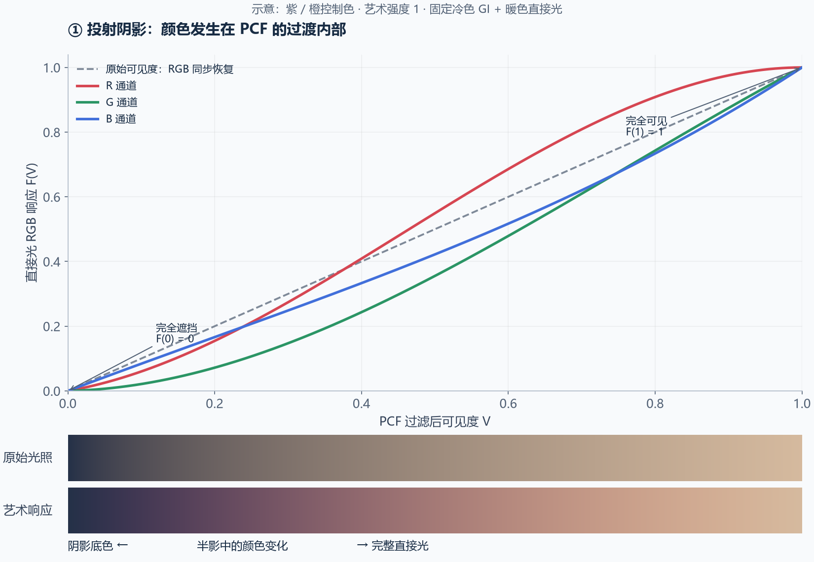
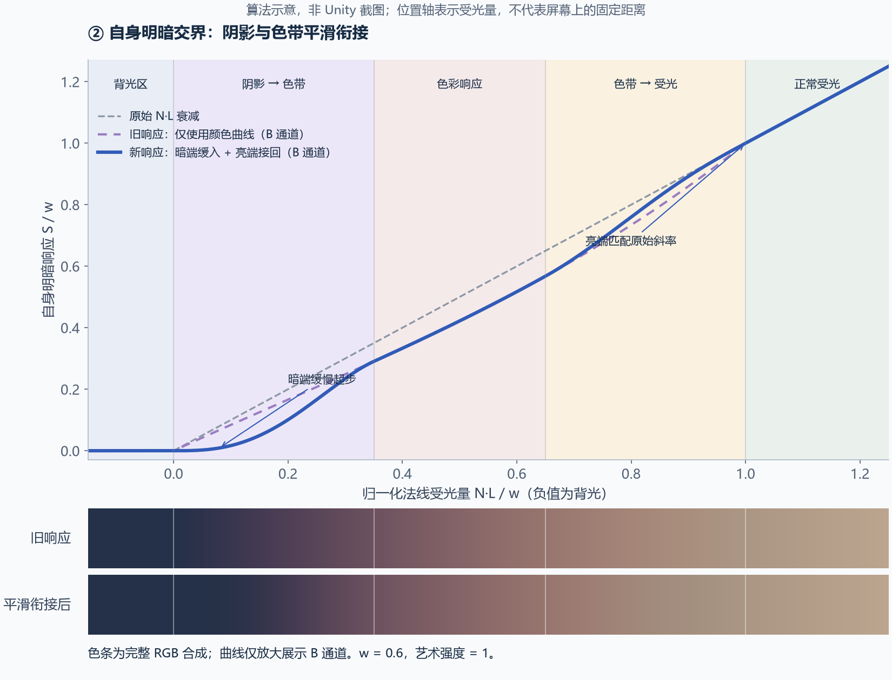
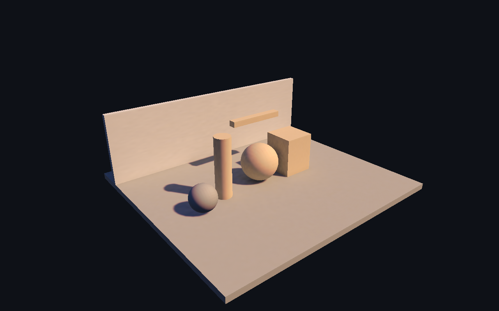

# 统一风格化阴影技术说明

## 1. 场景与实现范围

当前风格化实现位于 [UnityShadowBakeTest.unity](../../Assets/UnityShadowBakeTest/UnityShadowBakeTest.unity)，使用 Unity 原生实时阴影、烘焙 Shadowmask、Lightmap 和环境 SH。

目标是让投射阴影与物体自身明暗交界使用统一的颜色规律，并让阴影底色平滑进入色带。处理发生在主光源的直接光贡献中；烘焙 GI、环境 SH、其他光源和自发光不经过艺术颜色曲线。

这是有意偏离物理的艺术响应。原有暖色直接光与冷色环境光的组合仍然存在，但额外的色带来自下文的非线性 RGB 衰减。

工程中另有早期解析光照案例 `Assets/ShadowChromaticDemo/ChromaticShadowDemo.unity`，它使用近似天空/地面半球照明，不包含本文完整的 Unity 混合阴影接收路径。本文以 UnityShadowBakeTest 场景为准。

## 2. 从普通衰减到 RGB 响应

普通主光源直接光可以简化为：

\[
L_d=f_{BRDF}\odot C_{light}\;xV,\qquad x=\max(N\cdot L,0)
\]

- `V` 是阴影可见度：0 表示完全遮挡，1 表示完全可见。
- `x` 表示法线朝光程度，产生表面自身的明暗变化。
- `C_light` 包含光源颜色与强度。
- `f_BRDF` 表示材质反射响应；实际实现仍使用 URP 原生 BRDF。

`x` 与 `V` 原本都是标量，所以 RGB 同比例衰减。风格化版本将它们分别替换成 RGB 向量：

\[
L_d^{art}=f_{BRDF}\odot C_{light}\odot\mathbf S(x)\odot\mathbf V_{color}
\]

两条路径共享颜色曲线，但保留各自的输入：投影取可见度，表面明暗取法线受光量。

## 3. 共享的 RGB Bézier 曲线

`TA_TransitionResponse(t)` 使用三次 Bézier 曲线：

\[
\mathbf F(t)=3(1-t)^2t\mathbf P_1+3(1-t)t^2\mathbf P_2+t^3\mathbf1
\]

端点固定为 `F(0) = (0,0,0)`、`F(1) = (1,1,1)`。设艺术强度为 `a`，暗侧与亮侧控制色为线性空间的 `C_dark` 和 `C_lightControl`：

\[
\mathbf P_1=lerp(\tfrac13\mathbf1,\tfrac12\,saturate(\mathbf C_{dark}),a)
\]

\[
\mathbf P_2=lerp(\tfrac23\mathbf1,\tfrac12\mathbf1+\tfrac12\,saturate(\mathbf C_{lightControl}),a)
\]

每个通道满足 `0 ≤ P1 ≤ 0.5 ≤ P2 ≤ 1`，因此曲线逐通道单调。暗侧、亮侧颜色控制的是各通道恢复的速度，不是画面上直接叠加的目标颜色。控制器通过 `Color.linear` 转换后上传颜色。

当 `a = 0` 时，控制点回到 `1/3` 与 `2/3`，得到 `F(t) = t`。运行时在总光照视图且强度小于 `0.0001` 时直接调用原生 `LitPassFragment`，避免基线发生数值漂移。

## 4. 投射阴影：对过滤后的覆盖率着色



图中灰色虚线是原始标量响应，彩色曲线是 RGB 响应。暗侧蓝通道恢复较快，中部红通道逐渐占优，产生紫色到暖色的路径。下方色条包含固定冷色 GI 与暖色直接光，用于观察颜色混合。

图片按本文公式绘制，示意参数为紫/橙控制色、艺术强度 1；它不是 Unity 渲染截图，也不代表当前场景保存的参数。

### 4.1 为什么在 PCF 过滤后应用曲线

PCF 对多个深度比较结果进行加权：

\[
V=\frac{\sum_i w_iV_i}{\sum_iw_i},\qquad V_i\in\{0,1\}
\]

当前实现调用 Unity 原生阴影采样函数取得过滤结果，再对连续可见度应用 `F`。若对每个二值比较结果直接调用这条曲线，因为 `F(0)=0`、`F(1)=1`，最终仍然是普通灰度 PCF，无法产生中间颜色。

因此这里改变的是 PCF 输出的直接光响应，并未修改 Unity 的 PCF 核或每个比较采样。硬阴影若没有中间可见度，也不会凭空出现宽色带。

### 4.2 阴影强度和烘焙混合

`MainLightRealtimeShadow` 返回值已包含主光源阴影强度 `s`。代码先近似还原混合前的覆盖率：

\[
V_r=saturate\left(\frac{V_{unity}-(1-s)}{\max(s,0.0001)}\right)
\]

然后生成颜色响应并重新应用强度：

\[
\mathbf V_r=lerp(\mathbf1,\mathbf F(V_r),s)
\]

烘焙路径用 `_MainLightOcclusionProbes` 选择 Shadowmask 通道，同样先应用 `F`，再应用强度。最后沿用 Unity 的距离混合规则：

- 定义 `LIGHTMAP_SHADOW_MIXING` 时，使用 `min(lerp(realtimeRGB, 1, fade), bakedRGB)`，`min` 逐通道计算。
- 其他情况使用 `lerp(realtimeRGB, bakedRGB, fade)`。
- 关闭材质接收阴影时，投影响应返回白色；表面自身的法线明暗变化仍然存在。

投影色带宽度仍由实时过滤或烘焙半影决定。距离淡出、强度混合发生在颜色响应之后，避免把距离变化本身当作需要染色的几何半影。

## 5. 自身明暗交界：阴影底色与色带衔接



图的横轴是 `N·L / w`，负值表示背光；曲线选择 B 通道展示，色条则包含完整 RGB。`w = 0.6`、艺术强度 1，仅用于讲解。横轴不是屏幕位置或世界距离。

### 5.1 原有连接为什么容易显硬

设 `x = max(N·L, 0)`，`w` 为自身明暗处理范围，`t = x / w`。最初的自身响应是：

\[
\mathbf S_{old}(x)=w\mathbf F(t),\quad 0<x<w
\]

超过 `w` 后恢复 `S(x)=x`。虽然端点数值一致，但 Bézier 曲线两端的斜率通常不等于相邻区间的斜率，可能在阴影进入色带、色带恢复正常受光的位置显出折痕。

### 5.2 暗端缓入

当前实现增加暗端权重：

\[
b_s=lerp(1,smoothstep(0,0.35,t),a),\qquad \mathbf R=\mathbf F(t)b_s
\]

靠近背光区域时，直接光缓慢起步，画面里的环境光底色逐渐融入色带。`a=1` 时直接光响应在零点的斜率为零；较低艺术强度保留部分原始起始斜率。

它不会修改 GI，也不会向 `N·L ≤ 0` 的表面添加直接光。所谓“阴影与色带融合”，是让直接光贡献从零平滑增长，而阴影底色持续保留在最终求和中。

### 5.3 亮端接回

在处理范围末端使用：

\[
b_l=smoothstep(0.65,1,t)
\]

\[
\boxed{\mathbf S(x)=w\;lerp(\mathbf R,t\mathbf1,b_l)}\qquad(0\leq x<w)
\]

当 `x ≥ w` 时直接返回 `x`。在 `t=1` 处，混合权重达到 1 且其导数为零，因此恢复原始余弦衰减的数值与斜率。`0.35` 和 `0.65` 是当前实现固定的艺术区间划分。

对应代码：

```hlsl
float t = ndotl / width;
float shadowBlend = lerp(1.0, smoothstep(0.0, 0.35, t), saturate(_TAArtStrength));
float3 response = TA_TransitionResponse(t) * shadowBlend;
float lightBlend = smoothstep(0.65, 1.0, t);
return width * lerp(response, t.xxx, lightBlend);
```

## 6. 与 URP PBR 的接入

`TA_DirectTransmission` 将自身响应与投影响应逐通道相乘。`TA_ArtisticMainLight` 用彩色衰减与原生 `N·L × shadowAttenuation` 的比值调整主光源颜色，再调用 `LightingPhysicallyBased`。

实现对接近零的分母使用下限保护；原生衰减为零时不会通过比值路径补光。这保留了原生 BRDF 的调用结构，但非零艺术强度也会影响主光源的高光和清漆贡献，不是仅给漫反射底色染色。

`TA_UniversalFragmentPBR` 基于项目安装的 URP 17.5 `UniversalFragmentPBR`，只替换主光源的直接光计算入口，GI、额外光源、自发光及 AO 路径保留原有实现。最终仍由接收 Shader 应用原生雾效和透明度输出。

主光源完全被遮挡或表面完全背光时，艺术直接光为零，但环境光、其他灯和自发光仍然可能照亮表面。`F(1)=1` 只保证投影响应完全可见时不变；自身明暗响应仍可能改变同一像素。

## 7. 文件与控制参数

| 文件 | 职责 |
| --- | --- |
| [UnityArtisticLighting.hlsl](../../Assets/ShadowChromaticDemo/Shaders/UnityArtisticLighting.hlsl) | Bézier 曲线、阴影混合、自身平滑连接、主光源 PBR 接入 |
| [UnityMixedShadowReceiver.shader](../../Assets/ShadowChromaticDemo/Shaders/UnityMixedShadowReceiver.shader) | Lit 材质接口、Lightmap/SH 输入、原生基线和诊断输出 |
| [UnityMixedShadowComparison.cs](../../Assets/ShadowChromaticDemo/UnityMixedShadowComparison.cs) | 统一参数、材质切换和运行时面板 |
| [MixedShadowReceiverTest.cs](../../Assets/ShadowChromaticDemo/Editor/MixedShadowReceiverTest.cs) | 同参数原生对照、分项验证、截图和状态恢复 |

| 参数 | 含义与调节方法 |
| --- | --- |
| `artEnabled` / `artStrength` | 控制艺术处理和强度；关闭或归零可查看原生基线 |
| `artTerminatorWidth` | 自身明暗处理的 `N·L` 范围；增大会覆盖更多朝光表面，不改变投影 PCF 宽度 |
| `shadowEdgeColor` | 暗侧 RGB 曲线控制色；名称为兼容场景序列化而保留 |
| `lightEdgeColor` | 亮侧 RGB 曲线控制色，不是最终叠加色 |
| `viewMode` | 0 总光照、1 GI/SH、2 混合可见度、3 Shadowmask、4 响应变化区域 |

参数当前是 Shader 全局量，由相机上的控制器上传，对使用此接收 Shader 的物体统一生效。它们不是独立材质属性；多个控制器会互相覆盖全局设置。诊断视图 4 仅显示响应差异，不参与画面叠色。

## 8. 场景操作与验证

1. 打开 `Assets/UnityShadowBakeTest/UnityShadowBakeTest.unity`。
2. 在 Main Camera 的 `UnityMixedShadowComparison` 中调整参数，或进入 Play Mode 使用左上角面板。
3. 使用 `Native URP Lit baseline` 切换对照。原生材质引用保留安装时的输入；若后来只修改接收材质，两者参数可能不同。自动验证会基于当前接收材质临时创建同参数 Lit 材质，避免误判。
4. 运行 `Tools > TA > Mixed Shadow Receiver > Verify Current Scene`，查看 [Validation.txt](../../Assets/UnityShadowBakeTest/Comparison/Validation.txt)。

验证结束会恢复灯光、遮罩、质量选项、投影状态和艺术参数，并保存当前场景。六个静态物体使用 Lightmap，额外小球使用 SH 回退；场景尚无局部 Probe Group。

当前报告的主要结果：

| 检查 | 结果 |
| --- | --- |
| 关闭艺术处理，Distance Shadowmask 原生/自定义差异 | 0 像素（阈值 2/255） |
| 关闭实时投影，仅烘焙遮罩的原生/自定义差异 | 0 像素（阈值 2/255） |
| 烘焙艺术处理 / 自身明暗处理 / 实时混合艺术处理 | 均产生可检测的图像变化 |
| 响应诊断区域外的变化 | 0 像素（阈值 3/255） |
| 直接光归零，艺术开关对间接光的影响 | 0 像素（阈值 2/255） |
| 艺术强度归零与原生结果差异 | 0 像素（阈值 2/255） |

区域诊断与着色共享计算，只能辅助检查处理范围，不能独立证明所有边缘的视觉平滑性。仍需检查实际球体、圆柱和投影边缘。



上图是验证脚本以固定测试参数生成的 Unity 截图，可能与当前编辑器中保存的艺术控制色不同。自身衰减的隔离截图见 [ArtisticSelfShadow.png](../../Assets/UnityShadowBakeTest/Comparison/ArtisticSelfShadow.png)。

## 9. 成本与边界

- 当前范围为主方向光、不透明材质，已在 Unity 6000.5.7f1 / URP 17.5 / Windows DX12 验证。
- 主光源着色额外执行一次阴影采样调用以取混合前覆盖率；软阴影调用内部可能包含多个比较采样，尚未测量 GPU 成本。
- 该算法不生成真实面积光半影，不包含 PCSS 接触硬化，也不执行物理光谱散射。
- 自身明暗范围是角度域范围。平面、硬法线、低面数曲面或法线贴图不连续仍可能产生明显分界，标量曲线无法自动平滑几何法线。
- 曲线连接改善自身衰减的斜率，但不会消除 Shadow Map 分辨率、偏移、级联切换、烘焙噪声或实时/烘焙 `min` 混合造成的所有伪影。
- 原生烘焙采用低采样测试档，不能把其噪声当作颜色曲线错误。
- 复用原生 ShadowCaster、DepthOnly、DepthNormals、Meta、MotionVectors；新增艺术响应不要求重新烘焙已有 Lightmap/Shadowmask。
- 升级 URP 时需核对复制的 PBR 入口及阴影混合函数。透明材质、XR、复杂法线贴图和局部探针/APV 尚未完整验证。

## 10. 配图维护

两张算法图位于本文的 `images/` 子目录，随项目保存，不依赖会话临时目录。对应绘图脚本为 [generate_figures.py](tools/generate_figures.py)，依赖 Python、NumPy、Matplotlib，以及 Windows 微软雅黑字体。

修改 Shader 曲线、衔接位置或参数解释后，同步更新脚本和图片。在项目根目录使用已安装这些依赖的 Python 执行：

```powershell
python Docs/ShadowChromaticDemo/tools/generate_figures.py
```
