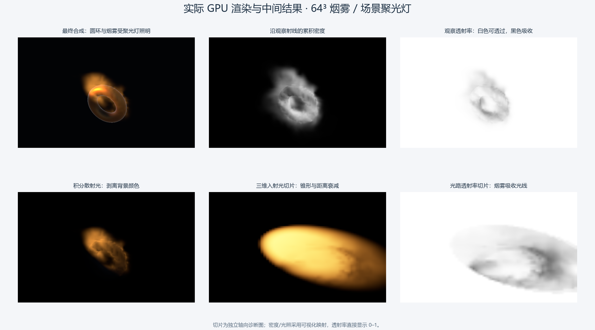

# 场景灯光驱动的烟雾体积光与中间视图

当前版本支持场景中的方向光、点光源和聚光灯照亮烟雾。原模型仍走 URP/Lit，烟雾走独立的单次散射体积渲染。原来的固定示例光照已移除。

## 运行与查看

打开 [VolumeSmokeLightingDemo.unity](../../Assets/VolumeSmoke3D/VolumeSmokeLightingDemo.unity)，点击 Play。示例预设一盏暖色聚光灯，烟雾、圆环都会受光。已有 `VolumeSmoke3DDemo` 也自动使用新的场景灯光路径，无需重建旧场景。

灯需要启用，Culling Mask 需要覆盖模拟对象所在层（示例为 Layer 26）；开启 URP Rendering Layers 时还需要与源 Renderer 的 Rendering Layer 匹配。灯不必与烟雾放在同一个 GameObject Layer。当前取相机可见灯列表中前 `Max Volume Lights` 盏支持的灯，上限 8；不按亮度排序，超出上限的灯不参与烟雾光照。

聚光灯必须朝向烟雾，Range 覆盖烟雾区域。默认新灯强度 1 在远处可能非常暗；独立示例使用约 3 米距离、Intensity 45、Range 12、Spot Angle 48°。这些值是演示参数，不是物理曝光标定。

Game 面板第一组按钮仍是模型捕获：Smoke / Mask / Depth / Normals / Motion。第二组为烟雾中间视图，可实时切换；Inspector 的 `Volume Smoke Camera` 同样可设置。选中中间体积视图时退出源捕获显示，反之亦然。

| 面板显示 | 含义 | 如何读图 |
|---|---|---|
| Composite | 最终合成 | 散射光 + 背景 × 观察透射率 |
| Density ray | 沿观察射线积分的密度 | 越亮代表累积密度越大，使用指数映射显示；不是原始线性数值 |
| View T | 观察射线透射率 | 白色可透过，黑色被烟雾吸收；受场景深度裁剪 |
| Scattering | 积分散射光 | 黑背景，只看烟雾散射出的光 |
| Density slice | 三维密度切片 | 越亮密度越高，Gain 控制可视化映射 |
| Light slice | 直接光切片 | RGB 已包含灯颜色、衰减、烟雾吸收和相函数；显示使用指数映射 |
| Light T slice | 光路透射率切片 | 白色光未被烟雾吸收，黑色光被吸收；无有效灯贡献处为白色 |
| Obstacle | 动态障碍切片 | 白色为重建固体，黑色为流体可占据区域 |
| Source band | 发射带切片 | 颜色为世界法线映射，亮度乘源权重 |
| Velocity | 速度切片 | RGB 为世界速度 XYZ 的绝对值，正负方向不区分；显示使用指数映射 |
| Divergence | 投影后散度切片 | 红色为正，蓝色为负，黑色接近零；Gain 放大小数值 |

切片中 X 显示 YZ，Y 显示 XZ，Z 显示 XY。位置滑块 0→1 对应世界模拟盒该轴的最小→最大坐标。这是整个网格的轴向诊断图，铺满画面，不经过相机透视和场景深度遮挡。某张切片全黑时，沿轴移动滑块查找有烟的区域；障碍/发射带仅占很窄区域。

`Gain` 只改变调试显示，不改变模拟、光强或烟雾消光。`View T` 与 `Light T slice` 直接显示 0–1，Gain 不影响它们。



单张原始输出保存在 [Preview/Lighting](../../Assets/VolumeSmoke3D/Preview/Lighting/04-composite.png) 下，包括最终合成、11 种体积视图、关灯和聚光灯转离的对照。

## 数据流与资源

1. Update 推进三维流体，输出当前密度，不再计算固定方向光照。
2. RenderGraph 捕获/重建动态表面，行为保持不变。
3. `VolumeSmokeFeature` 从 `UniversalLightData.visibleLights` 快照灯位置、方向、最终颜色与强度、范围、内外锥角。使用与体积/源 Renderer 对应的层过滤。
4. `SceneLighting` Compute 对每个体素计算有效灯贡献，写入临时 RGBA16F 三维纹理。
5. Raymarch 采样密度与该光照纹理，积分散射与观察透射率，输出当前显示模式。

临时光照体积 RGB 是含相函数的直接入射光，A 是以未受烟雾吸收的入射光亮度加权的平均光路透射率。A 用于诊断，不是把多盏灯的透射率相乘；RGB 计算时分别保留了各灯吸收。

每个观察相机拥有自己的 RenderGraph 临时光照体积。相函数依赖观察方向，因此不同观察相机不能直接共享这个 RGB。纹理无需持久历史或手动 Release，完整写入后由图管理；流体持久纹理由模拟组件管理。暂停流体后，灯移动、颜色/强度变化、相机移动和消光调整仍会在渲染时重算。

64³ 持久流体数据为 23 MiB，额外光照体积约 2 MiB/观察相机；不含屏幕捕获、相机颜色深度及驱动对齐。默认流体每步 40 次 Dispatch（32 次 Jacobi + 8 次其他更新），每个观察相机增加 1 次光照 Dispatch。光照密度采样量的上界约为 `N³ × 灯数 × Light Steps`，范围/锥形外会跳过光路积分。默认 64³、12 步；这是计算量说明，没有 GPU 毫秒性能基准。

## 衰减与散射

对距离平方 `d²`、范围 `R`，点光/聚光使用平滑截断的反平方衰减，与本项目 URP 的距离衰减形式一致：

```text
rangeFade = saturate(1 - (d² / R²)²)
distanceAttenuation = rangeFade² / max(d², 0.01)
```

方向光距离衰减为 1。近光源区域限制最小距离平方，避免数值奇点。

聚光灯额外乘锥形角度衰减；`theta` 是灯前向与灯到采样点方向的夹角，内外角使用 Inspector 完整锥角的一半：

```text
cone = saturate((cos(theta) - cos(outer/2)) /
                max(cos(inner/2) - cos(outer/2), 0.001))
spotAttenuation = cone²
```

从当前体素向光源追踪。方向光追踪到模拟盒边界；点光与聚光追踪到灯位置或盒边界中较近的位置，固定步数在整个有效光路上等距采样：

```text
tauLight = sum(density(sample) × lightStepLength)
T_light = exp(-extinction × tauLight)
```

颜色与强度来自 `VisibleLight.finalColor`，不重复做 gamma 转换。相函数采用 HG，`g = Anisotropy`：

```text
phase = (1-g²) / max(1+g²-2g*cosTheta, 0.01)^(3/2)
L_direct = sum(lightColor × distanceAttenuation × spotAttenuation × T_light × phase)
```

相函数以各向同性为 1 归一化，省略的 `1/(4*pi)` 吸收在示例的艺术光强尺度里。g=0 为各向同性，正值增强沿光传播方向的前向散射。该效果是单次散射近似，没有多次散射/能量标定。

观察射线在场景深度与模拟盒裁剪后的区间上积分：

```text
T_step = exp(-density × extinction × viewStepLength)
illumination = (AmbientLight + L_direct) × ScatteringAlbedo
C += T_view × (1 - T_step) × SmokeColor × illumination
T_view *= T_step
final = C + background × T_view
```

光路和观察射线共用 `Extinction`。`Ambient Light` 为显式艺术环境光，不自动采样场景 SH/天空盒；`Scattering Albedo` 允许 0–4 作为艺术增益，超过 1 时不具有物理反照率含义。

## 已实现边界

- 支持烟雾自身吸收灯光、光路透射率和观察透射率，形成烟雾中的聚光锥与明暗变化。没有密度的空气不散射，不会凭空画出完整光束。
- 不读取 URP 实体阴影贴图。因此物体可以通过场景深度遮住后方烟雾，但当前不会在烟雾里投射实体阴影。烟雾也不向实体表面投影。
- 不处理 Light Cookie、IES、矩形/圆盘区域光、烘焙灯的完整混合模式或体积专用光层。透明物体排序仍是原来的近似。
- 自遮挡步数有限，低分辨率光照体积会出现柔化、光锥边缘台阶；增加 Light Steps 改善光路积分，但无法突破网格本身分辨率。
- 中间切片是调试映射，经过指数/截断显示后的图像不应当作原始 HDR 数值导出。

## 验证和代码入口

菜单 **Tools > TA > Volume Smoke 3D > Verify Scene Lighting and Export Views** 会在独立场景验证灯光公式、生成渲染预览，并保存单独的灯光示例场景。不会覆盖原三维场景或当前用户场景；验证期间暂时禁用已有灯与 Layer 26 的 Renderer，结束时恢复。

自动化请求文件为 `Library/VolumeSmokeLighting.request`（内容 `validate`）；运行中的 Play 会退出后执行。报告为 `Library/VolumeSmokeLighting-validation.txt`。包含：点光距离衰减、聚光锥方向、强度线性、均匀密度的解析透射率、无灯输出、最终散射对灯启用/朝向变化的响应，以及全部中间视图导出。同步 GPU Readback 仅用于验证。

2026-10-28 在 RTX 4060 Laptop / DX12 上通过验证：[原始报告快照](Verification-Lighting-2026-10-28.txt)。点光距离 2→4 时红通道贡献 0.249950→0.062300；聚光灯转离后为 0；均匀密度的实测与解析光路透射率均为 0.317429。连续捕获保持一盏灯，关灯归零，避免 RenderGraph 复用 PassData 时累加旧灯数。

总览图由 [generate_lighting_sheet.py](diagrams/generate_lighting_sheet.py) 从实际导出图片排版生成，可在重新验证后运行该脚本更新。

- [VolumeSmoke.compute](../../Assets/VolumeSmoke3D/Shaders/VolumeSmoke.compute)：`SceneLighting`。
- [VolumeSmokeFeature.cs](../../Assets/VolumeSmoke3D/VolumeSmokeFeature.cs)：灯快照、过滤、临时体积和 RenderGraph 依赖。
- [VolumeSmoke.shader](../../Assets/VolumeSmoke3D/Shaders/VolumeSmoke.shader)：散射积分与中间显示。
- [VolumeSmokeCamera.cs](../../Assets/VolumeSmoke3D/VolumeSmokeCamera.cs)：光照参数和查看面板。
- [VolumeSmokeLightingValidator.cs](../../Assets/VolumeSmoke3D/Editor/VolumeSmokeLightingValidator.cs)：GPU 数值与实际渲染验证。

参考：[Unity RenderGraph Compute Pass](https://docs.unity3d.com/6000.0/Documentation/Manual/urp/render-graph-compute-shader-run.html)、[GPU Gems 3 三维流体模拟与渲染](https://developer.nvidia.com/gpugems/gpugems3/part-v-physics-simulation/chapter-30-real-time-simulation-and-rendering-3d-fluids)。
