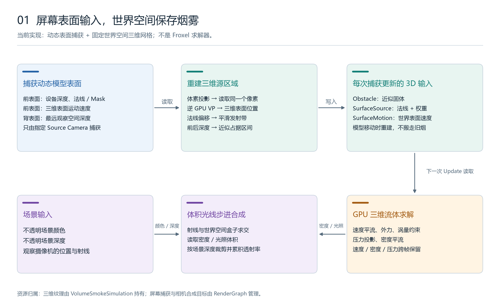
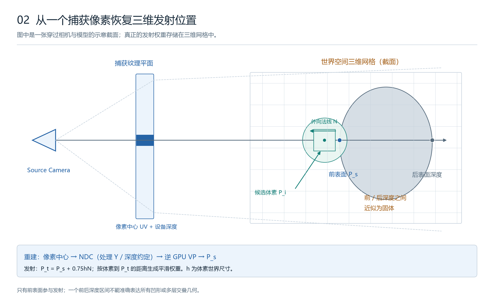
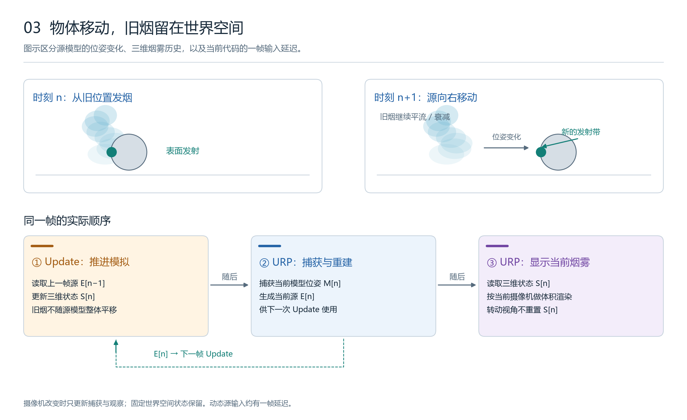
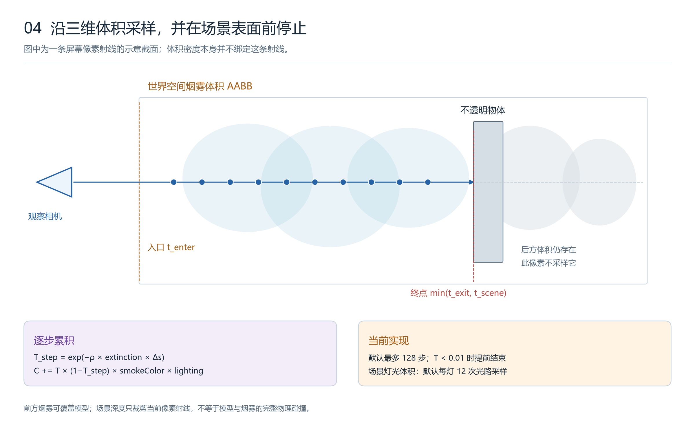
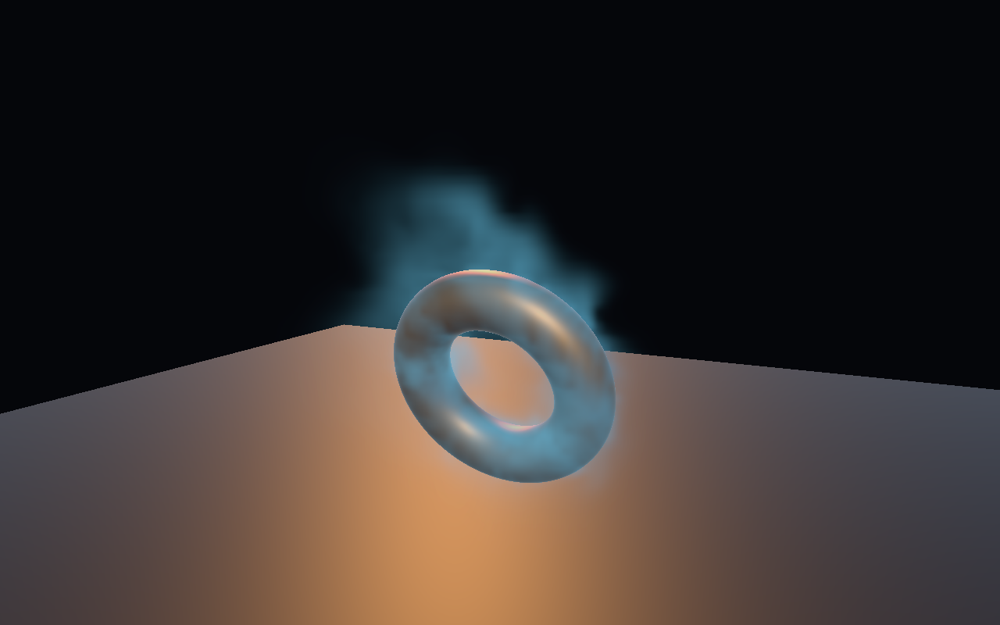
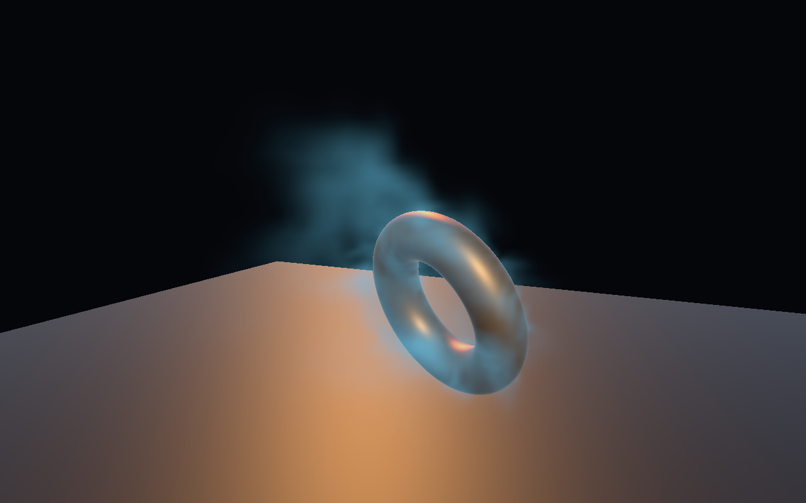
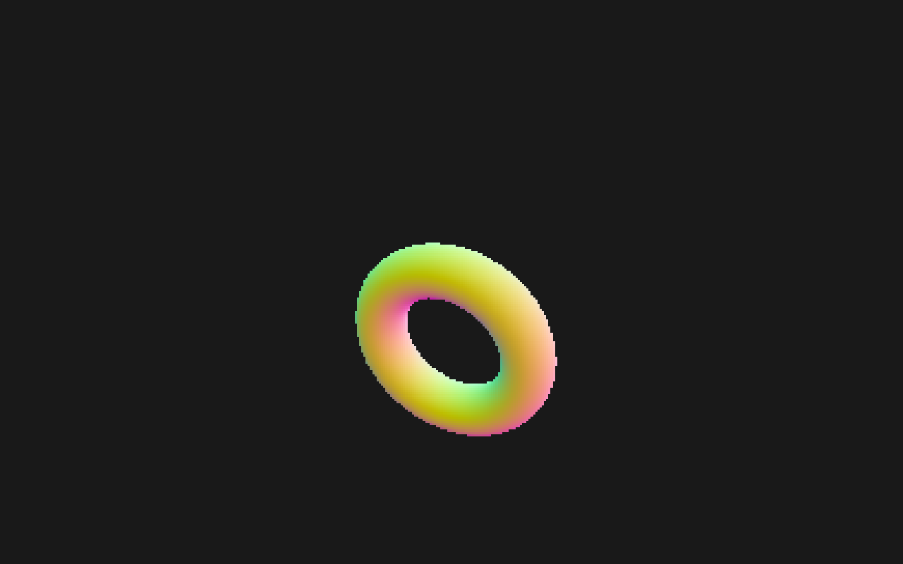

# 屏幕表面重建驱动的三维烟雾：技术说明与讲解图

本文对应 `Assets/VolumeSmoke3D` 的当前实现，记录于 **2026-10-28**。场景灯光、衰减和中间视图详见 [体积光与调试说明](LightingGuide.md)。适用于本项目 Unity **6000.5.7f1**、URP **17.5**、RenderGraph、桌面 **Direct3D 12** 和普通透视摄像机。

**核心结构是：从屏幕捕获动态模型的表面，再把这些表面信息变成三维发射输入；烟雾的速度、压力和密度始终保存在世界空间三维网格中。**

## 1. 系统解决什么问题

目标是让一个保留原外观的物体持续发烟，并支持物体平移、旋转：新烟跟随当前模型表面产生，已散出的烟保留世界位置、继续流动。自由摄像机可以从侧面、背面观察同一团烟。

本例将两个问题分开处理：

| 问题 | 当前实现 |
|---|---|
| 当前模型表面在哪里、朝向哪里、怎样运动 | 每帧屏幕捕获与逆投影重建 |
| 已有烟雾下一步怎样运动 | 三维速度场、压力投影、密度平流 |
| 烟雾如何显示并遮挡模型 | 三维密度的体积光线步进与场景深度裁剪 |



图 1 的上排是动态发射源输入；右下是保存历史的世界空间模拟；中下是观察当前模拟状态的体积渲染。SVG 源图见 [01-system-overview.svg](images/01-system-overview.svg)。

### 1.1 与其他“屏幕空间流体”的区别

| 方案 | 持久模拟状态 | 当前是否实现 |
|---|---|---|
| 二维屏幕网格烟雾 | 屏幕 XY 中的速度、压力、染料 | 另存于 [ScreenGridSmoke 示例](../../Assets/ScreenGridSmoke/README.md) |
| 粒子 + 屏幕空间液面重建 SSF | 世界空间粒子，屏幕上重建液面 | 另存于 [ScreenSpaceFluid 示例](../../Assets/ScreenSpaceFluid/README.md) |
| 本例：屏幕发射源 + 世界空间体积 | 固定世界空间 XYZ 网格 | 本文内容 |
| 摄像机对齐/Froxel 三维求解 | 随视锥变化的 XYZ/深度切片 | 尚未实现 |

因此，靠近物体时，提高捕获分辨率只能改善发射源输入；当前三维烟雾的最小模拟尺度仍由固定世界网格决定，并不会自动变细。

## 2. 模块与责任边界

代码相对本文件位于 `../../Assets/VolumeSmoke3D/`。

| 文件 | 责任 |
|---|---|
| [VolumeSmokeSimulation.cs](../../Assets/VolumeSmoke3D/VolumeSmokeSimulation.cs) | 拥有三维纹理、计算 Shader 实例；初始化、推进、重置与释放模拟 |
| [VolumeSmokeFeature.cs](../../Assets/VolumeSmoke3D/VolumeSmokeFeature.cs) | 选择捕获相机；记录模型捕获、源重建 Compute Pass 和体积合成 Pass |
| [VolumeSourceCapture.shader](../../Assets/VolumeSmoke3D/Shaders/VolumeSourceCapture.shader) | 输出前表面设备深度、世界法线/Mask、刚体表面速度，以及最远背表面深度 |
| [VolumeSmoke.compute](../../Assets/VolumeSmoke3D/Shaders/VolumeSmoke.compute) | 屏幕源重建、三维流体更新、光照体积计算 |
| [VolumeSmoke.shader](../../Assets/VolumeSmoke3D/Shaders/VolumeSmoke.shader) | 体积光线步进、场景深度裁剪、捕获数据调试显示 |
| [VolumeSmokeCamera.cs](../../Assets/VolumeSmoke3D/VolumeSmokeCamera.cs) | 摄像机上的模拟引用、捕获分辨率、显示参数与运行面板 |
| [VolumeSmokeFreeCamera.cs](../../Assets/VolumeSmoke3D/VolumeSmokeFreeCamera.cs) | 使用 Unity Input System 实现右键自由视角 |
| [VolumeSmokeSourceMotion.cs](../../Assets/VolumeSmoke3D/VolumeSmokeSourceMotion.cs) | 示例中的可开关平移/旋转动画，不是求解器必需组件 |
| [VolumeSmokeDemoBuilder.cs](../../Assets/VolumeSmoke3D/Editor/VolumeSmokeDemoBuilder.cs) | 生成场景、配置独立 Renderer、编译 Shader、执行 GPU 正确性验证 |

运行程序集依赖 URP、Core RP 和 Input System；Editor 程序集依赖运行程序集。模拟组件不依赖 Editor 生成器，也不在正常运行中调用 GPU 读回。

## 3. 模型表面捕获

### 3.1 谁负责捕获

`simulation.sourceCamera` 指定唯一的捕获摄像机；未设置时回退到 `Camera.main`。这个摄像机需要挂 `VolumeSmokeCamera` 并使用包含 `VolumeSmokeFeature` 的 URP Renderer。

其他观察摄像机可以引用同一个 `VolumeSmokeSimulation`，读取相同密度，各自计算含观察方向散射的临时光照体积，但不会重复更新源。当前设计要求捕获相机正常情况下每帧捕获一次；额外调用同一摄像机的 RenderRequest 会再次捕获并更新历史模型矩阵。

Feature 在 `BeforeRenderingTransparents` 执行，要求不透明场景深度和中间颜色目标存在。捕获只绘制 Source 所引用的 MeshFilter 网格，不绘制整个场景。

### 3.2 前表面 MRT

`FrontDepthNormalMotion` 使用 `Cull Back`、`ZWrite On` 和最近表面深度测试。输出到三张颜色纹理，并使用独立深度附件选出最近表面。

| 纹理 | 格式 | 内容 |
|---|---|---|
| `Source / front device depth` | R32F | 前表面的设备深度，来自片元 `SV_POSITION.z` |
| `Source / world normals and mask` | RGBA16F | RGB：归一化世界法线；A：有效表面为 1，清空区域为 0 |
| `Source / world surface motion` | RGBA16F | RGB：世界空间表面速度；A：有效标记 |
| `Source / closest surface Z` | Depth32 | 仅用于最近表面选择，不直接参与后续源重建读取 |

Mask 并不是另一张独立纹理，而是世界法线目标的 Alpha 通道。

默认捕获高度 `captureHeight = 256`，宽度按摄像机目标的宽高比计算。1280×800 视口对应约 **410×256** 的捕获目标。

### 3.3 背表面深度

`FarthestBackDepth` 使用 `Cull Front`，输出正的观察空间深度；`BlendOp Max` 保留每像素最远背面。目标为 R32F，初值为 0。

前表面存的是设备深度，背表面存的是线性观察空间深度，二者不能直接比较。代码先把前表面重建为世界位置，再转回观察空间，得到可以与背面比较的 `frontEye`。

### 3.4 表面运动速度

对相同的模型局部顶点位置 \(p_o\)，使用当前与上一次捕获时的模型矩阵：

\[
v_s=\frac{M_n p_o-M_{prev}p_o}{\max(\Delta t_{capture},10^{-4})}
\]

这包含平移、旋转和普通矩阵缩放造成的表面运动；没有把摄像机位移算进物体速度。因此，只移动摄像机而模型不动，不应生成虚假的刚体表面速度。

此速度基于刚体/仿射模型矩阵，并不是骨骼或 BlendShape 的逐顶点上一帧速度。捕获使用替换 Shader，也不会自动复现原材质里的 Alpha Clip、自定义顶点动画或透明镂空。

## 4. 从捕获像素重建三维发射源



图 2 显示的是空间截面，便于看清一个像素、一条射线、表面点和候选体素的关系；实际输出是三维纹理。[SVG 源图](images/02-source-reconstruction.svg)。

### 4.1 坐标约定

设模拟盒边长为 \(L\)、每轴分辨率为 \(N\)、世界空间最小角为 \(B_{min}\)。体素尺寸及中心为：

\[
h=\frac{L}{N},\qquad P_i=B_{min}+\frac{i+0.5}{N}L
\]

默认 \(L=6\)、\(N=64\)，所以 \(h=0.09375\) 世界单位。屏幕捕获再清晰，也无法让当前模拟表达比体素尺度更细的独立流动结构。

捕获矩阵使用：

```csharp
captureView = cameraData.GetViewMatrix();
captureVP = GL.GetGPUProjectionMatrix(
    cameraData.GetProjectionMatrix(), true) * captureView;
```

捕获 Shader 和重建 Compute 使用同一份 GPU VP，避免采用不同投影约定。`true` 表示渲染到纹理。

### 4.2 体素收集屏幕样本

`ReconstructScreenSource` 对每个体素独立执行：

1. 将世界体素中心投影到捕获相机。
2. 处理 RenderTexture 的 Y 方向，得到捕获 UV。
3. 拒绝相机后方、视野外或 Mask 无效的样本。
4. 将 UV 量化为捕获像素坐标。
5. 读取该像素的深度、法线、背面深度和运动速度。

这是“每体素收集样本”，没有逐像素向体积进行加法散射，也不需要浮点原子累加。因此，捕获像素数增多不会直接增加注入次数。

不过，采样量化、可见面积和表面朝向仍会影响重建结果，不能把它理解为严格的、视角无关的表面积积分。

### 4.3 必须使用实际像素中心重建

设量化后的像素为 \(k\)，捕获尺寸为 \((W,H)\)，代码重新计算：

\[
uv_c=\frac{k+0.5}{(W,H)}
\]

再由 \(uv_c\) 和同一像素的设备深度构造 NDC 坐标：

\[
P_s=\operatorname{dehomogenize}\left(VP^{-1}_{GPU}
\begin{bmatrix}x_{ndc}&y_{ndc}&z_{ndc}&1\end{bmatrix}^{T}\right)
\]

不能读取某个像素的深度，却使用另一个连续 UV 的相机射线还原位置。当前代码显式使用样本像素中心，减少这种位置/深度错配。

深度输入是设备深度，不能先用 `LinearEyeDepth` 线性化后直接乘逆 VP。代码按平台处理 NDC 深度区间，并单独处理纹理 Y 翻转；目前实际验证平台是 DX12，其他图形后端没有通过本例的验证。

### 4.4 生成平滑发射带

读取归一化世界法线 \(n\)，把发射中心稍微移到表面外：

\[
P_t=P_s+0.75hn
\]

半径为 \(r=\max(h,\text{sourceBandCells}\cdot h)\)，默认 `sourceBandCells = 2`。对候选体素中心：

\[
s=\operatorname{saturate}\left(1-\frac{\lVert P_i-P_t\rVert}{r}\right),
\qquad w=s^2(3-2s)
\]

写入两张体积输入：

```text
SurfaceSource.rgb = 世界法线
SurfaceSource.a   = 发射权重 w
SurfaceMotion.rgb = 世界表面速度（限制最大长度后）
SurfaceMotion.a   = 发射权重 w
```

`Max Source Speed` 默认 15 世界单位/秒。速度限制用于防止模型瞬移或捕获间隔异常时产生过强输入，不是物理上的碰撞速度上限。

## 5. 动态障碍与运动物体

### 5.1 前后深度区间近似

对已匹配捕获像素的体素，计算它的观察空间深度 \(z_i\)。当前固体判定为：

\[
z_b>z_f,\qquad z_f+0.15h<z_i<z_b-0.15h
\]

满足时写 `Obstacle = 1`，并停止为该体素生成源权重。每次捕获都会先把所有输出体素置零，再重建新的占据区间，旧障碍不会留在原位置。

这是每条相机射线上的**单一区间**。如果一条射线依次穿过两个分离实体，最近前面和最远背面之间的空隙也可能被标为固体。它不是完整几何体素化或 SDF，尤其不保证复杂凹形、多层交叠和开放网格的碰撞正确性。

### 5.2 什么会跟随，什么不会跟随



[SVG 源图](images/03-motion-and-frame-order.svg)。

- 发射带、表面运动输入和近似障碍随模型捕获更新。
- 已有密度与速度不会随模型整体平移，继续在世界网格中演化。
- 模拟盒不会自动跟随物体；源离开盒子后，盒外不再注入。
- 移动摄像机不清空烟雾，但会改变下一次可捕获的源表面。

同一个模型的**背面并不会因为有背深度就自动发烟**。背深度当前仅帮助估计障碍；发射位置仍来自最近的前表面。

### 5.3 速度继承是局部松弛，不是完整动壁求解

当前外力更新后，对发射带施加：

\[
u\leftarrow\operatorname{lerp}\left(u',I\frac{v_s}{h},
\operatorname{saturate}(3w\Delta t)\right)
\]

其中 \(u\) 为格子/秒单位的速度，\(v_s\) 为世界单位/秒，\(I\) 为 `inheritSourceMotion`。

这是把发射带速度拉向源表面速度的视觉近似。设置 \(I=0\) 时，当前代码仍会把该带速度向零松弛，并不是完全移除这项阻尼。障碍压力边界仍采用零法向速度近似，没有把固体速度完整带入移动壁面条件，也没有流体对物体的反作用力。

## 6. 实际跨帧顺序

当前并不是“先捕获本帧源，再立刻用它求解本帧烟雾”。`VolumeSmokeSimulation.Update()` 和 URP Feature 分别执行：

```text
帧 n / Update
  读取 E[n-1]，推进速度、压力和密度，得到 S[n]

帧 n / URP BeforeRenderingTransparents
  捕获模型 M[n]
  ReconstructScreenSource 写入 E[n]
  从 S[n] 做体积渲染

帧 n+1 / Update
  使用 E[n] 继续推进 S[n+1]
```

这带来约一帧的动态源输入延迟，换来不依赖 GPU→CPU 同步回读的实现。模拟 Dispatch、重建 Compute Pass 和渲染位于同一 GPU 图形队列，不启用异步计算。

暂停时，Update 不推进烟雾；捕获和观察仍可继续。因此暂停后移动模型会改变源字段，但不会立即改变密度。恢复后才用新的源字段推进模拟。

`lastCaptureFrame` 检查用于识别停止渲染的源摄像机。有效源超过一帧未更新时清空源字段，避免旧位置无限发烟；已有烟雾继续流动和衰减。`SourceCaptureCount` 在 CPU 记录 Pass 时递增，不是一个 GPU 完成信号。

首次初始化会清零三维状态和源字段，第一帧 Update 尚没有有效发射输入，后续帧才开始注入。改变模拟分辨率、盒子大小或位置需要重建，并会清空历史。

## 7. 三维 GPU 求解

### 7.1 单位和时间步

速度纹理使用**格子/秒**，外部世界速度通过除以 \(h\) 转换。压力纹理存储的是投影用的修正势，不应当把数值直接解释为帕斯卡。

每次 `StepSimulation()` 使用 \(\Delta t=\min(\text{deltaTime},1/30)\)。当前每个 Update 最多推进一次，没有额外追赶子步；低帧率时会减慢模拟时间。

### 7.2 Kernel 顺序

| 顺序 | Kernel | 输入与结果 |
|---|---|---|
| 1 | `AdvectVelocity` | 用旧速度回溯并三线性采样，施加指数速度阻力 |
| 2 | `Forces` | 风、源法线外力、密度浮力、Y 轴旋转力、弱三维扰动和源速度松弛 |
| 3 | `ComputeCurl` | 用邻域速度差估计三维旋度 |
| 4 | `Confinement` | 根据旋度强度梯度补充卷曲运动 |
| 5 | `ComputeDivergence` | 记录投影前散度 |
| 6 | `Jacobi` | 默认 32 次迭代求解压力修正势 |
| 7 | `Project` | 减去压力梯度，施加障碍/盒子边界与速度上限 |
| 8 | `ComputeDivergence` | 记录投影后散度，供诊断验证 |
| 9 | `AdvectDensity` | 搬运密度、从源权重注入、衰减并裁剪固体内密度 |

场景光照由 `VolumeSmokeFeature` 的 `SceneLighting` Compute Pass 在渲染时计算；不再由模拟 Update 生成固定方向的光照。

压力迭代数截断为 20–80 范围内的偶数。四次速度双缓冲交换使最新速度留在槽 0；偶数次压力交换使压力留在槽 0；密度每步交换一次，由 `densityIndex` 记录当前槽。

### 7.3 平流与密度注入

对体素纹理坐标 \(q\)，半拉格朗日回溯为：

\[
q_{back}=q-\frac{u(q)\Delta t}{N}
\]

若回溯点处于障碍中，代码退回当前坐标。密度先从旧纹理采样并衰减，再注入：

\[
\rho_{new}=\rho_{advected}\,e^{-k\Delta t}
+w\,m(q,t)\,\text{emission}\,\Delta t
\]

其中 \(m(q,t)\) 为代码中的时空调制，范围约为 0.15–1，用于打破均匀发射。密度最大限制为 8，模拟盒边缘两格范围内会衰减，固体内部置零。该过程并不严格守恒烟雾质量。

### 7.4 涡量与压力投影

涡量约束使用：

\[
\omega=\nabla\times u,\qquad
n_\omega=\frac{\nabla |\omega|}{\max(|\nabla |\omega||,\epsilon)},\qquad
f_\omega=\text{vorticity}\,(n_\omega\times\omega)
\]

它补偿数值耗散造成的卷曲细节损失，不能替代提高网格分辨率。

压力部分使用匹配的前向散度 \(D^+\) 与后向梯度 \(G^-\)，使 \(D^+G^-\) 对应最近邻七点 Laplacian。无障碍邻域中的 Jacobi 更新为：

\[
p^{k+1}_{i,j,l}=\frac{p^k_{i-1,j,l}+p^k_{i+1,j,l}
+p^k_{i,j-1,l}+p^k_{i,j+1,l}
+p^k_{i,j,l-1}+p^k_{i,j,l+1}-d_{i,j,l}}{6}
\]

然后 \(u\leftarrow u-G^-p\)。障碍邻居压力使用中心压力，边界法向速度置零。有限迭代保留残余散度，速度钳制等艺术处理也会影响数值结果。本例没有完整高阶 MAC 平流、黏性扩散、多重网格或物理热力学系统。

## 8. 体积渲染与遮挡



[SVG 源图](images/04-volume-raymarch.svg)。

每个屏幕像素读取场景深度并重建世界位置，得到观察射线。射线与世界空间 AABB 求交：

\[
t_{start}=\max(0,t_{enter}),\qquad
t_{end}=\min(t_{exit},t_{scene})
\]

若终点不在起点之后，直接返回背景。否则在该区间按默认最多 128 步采样密度与光照，采用步区间中点，没有随机抖动或时间累积。

每步透射率及前向颜色累积为：

\[
T_s=e^{-\rho\,\text{extinction}\,\Delta s}
\]

\[
C\leftarrow C+T(1-T_s)C_{smoke}L,\qquad T\leftarrow TT_s
\]

最终输出 \(C+T\,C_{background}\)。当 \(T<0.01\) 时提前终止。

`SceneLighting` 从相机可见场景灯光中提取最多 8 盏方向光、点光、聚光灯，计算距离/范围/聚光锥衰减，以及沿光路的烟雾 Beer–Lambert 透射率和 HG 相函数。每个体素、每盏有效灯默认采样 12 次密度，写入临时 RGBA16F 体积；RGB 为含相函数与烟雾吸收的入射光，A 为按入射亮度加权的光路透射率。观察射线和光路共用 `extinction`。支持烟雾自遮挡，尚不读取实体物体阴影贴图。详见 [体积光与调试说明](LightingGuide.md)。

场景深度让不透明物体遮挡后方烟雾，前方烟雾也能覆盖模型。它仅控制当前像素的积分终点，不意味着所有场景物体都参与了三维压力/碰撞求解。合成不写回烟雾深度，后续透明物体排序仍是近似。

## 9. GPU 资源、生命周期与性能

### 9.1 持久三维纹理

以下纹理由 `VolumeSmokeSimulation` 拥有，尺寸都是 \(N^3\)。

| 内容 | 数量 | 格式 | 每体素总字节 | 64³ 时逻辑大小 |
|---|---:|---|---:|---:|
| 速度双缓冲 | 2 | RGBA32F | 32 | 8 MiB |
| 密度双缓冲 | 2 | R32F | 8 | 2 MiB |
| 压力双缓冲 | 2 | R32F | 8 | 2 MiB |
| 旋度 | 1 | RGBA32F | 16 | 4 MiB |
| 投影前后散度 | 2 | R32F | 8 | 2 MiB |
| 动态障碍 | 1 | R32F | 4 | 1 MiB |
| 源法线/权重 | 1 | RGBA16F | 8 | 2 MiB |
| 源速度/权重 | 1 | RGBA16F | 8 | 2 MiB |
| **合计** | **12** | — | **92** | **23 MiB** |

不计驱动对齐、相机目标与临时资源时，96³ 对应 77.625 MiB，128³ 对应 184 MiB。网格边长翻倍，体素数量与状态存储变成八倍。

### 9.2 临时纹理与资源归属

每个观察相机额外创建 RGBA16F 三维光照体积，64³ 约 2 MiB，生命周期由 RenderGraph 管理；含持久体积合计逻辑存储约 25 MiB（未计其他目标）。

四张源颜色纹理与 Depth32 附件的逻辑格式总和为每捕获像素约 28 字节；410×256 时约 2.8 MiB。这里是格式大小之和，不是 RenderGraph 经过生命周期复用后保证的实际峰值。

捕获目标、最近表面深度附件、最终合成目标由 RenderGraph 创建和回收。持久体积通过 `ImportTexture()` 声明依赖：源重建写入动态输入，体积渲染读取密度和光照。`AllowPassCulling(false)` 保证即使调试模式不直接显示源字段，重建仍能为后续 Update 提供输入。

正常运行没有 GPU→CPU 回读；验证器中的 Readback 是显式同步诊断，不能据此测量正常帧耗时。

### 9.3 生命周期

`Initialize()` 创建体积、克隆每实例计算 Shader 并查找 Kernel；失败时释放已建立的字段。`ResetSimulation()` 清空烟雾状态与源字段，不重新分配纹理。禁用、销毁或显式重新初始化会释放 RTHandle、RenderTexture 和计算 Shader 实例。

配置中的 `resolution`、`domainSize` 和体积 Transform 不会自动重映射已有密度；修改后执行 **Rebuild volume**。摄像机尺寸变化只影响捕获与观察目标，不重新分配三维状态。

### 9.4 开销构成与优化顺序

默认每次模拟更新约 **40 次 Compute Dispatch**：32 次压力迭代 + 8 次其他更新（包括投影后散度诊断）。每次源捕获额外有两次模型 Raster Pass 和一次全体积重建 Dispatch；每个观察相机还执行一次三维场景光照 Dispatch，最后一次全屏体积合成。光照成本约随体素数 × 灯数 × 光路步数增长。

源模型有多个子网格时，每个捕获 Pass 都会逐子网格提交。提高捕获分辨率增加 Raster/临时目标成本；提高体积分辨率增加全体积求解、源重建和光照成本；提高屏幕分辨率与 `raySteps` 增加体积渲染成本。

建议先在目标设备用 GPU Profiler 分开测量源捕获、源重建、压力迭代、光照体积和 Raymarch，再决定优化。当前没有统一条件下的 GPU 毫秒基准，不引用编辑器 Stats 的 FPS 作为本功能耗时。

可继续评估的优化包括：缩小世界模拟盒、降低压力诊断频率、半分辨率体积渲染加深度感知上采样，以及空区跳跃。这些均未在当前实现中完成。

## 10. 运行、接入和调试

### 10.1 运行示例

1. 打开 [VolumeSmoke3DDemo.unity](../../Assets/VolumeSmoke3D/VolumeSmoke3DDemo.unity)，点击 Play。
2. 点击 **Animate moving source**，观察模型运动后发射位置和烟雾拖尾。
3. 用 Mask、Depth、Normals、Motion 查看屏幕输入，再切回 Smoke。
4. 按住右键转向，右键 + WASD 移动，Q/E 升降，Shift 加速；右键 + 滚轮调速度，松开右键或按 Esc 释放鼠标。
5. Pause 冻结模拟后绕到侧面观察；旧烟不应因视角改变而清空。

### 10.2 替换模型

在 `VolumeSmokeSimulation.Source` 指定 MeshFilter，保留原 MeshRenderer。**不需要启用 Read/Write**，因为捕获直接绘制 GPU 网格，不在 CPU 读取顶点。

指定正确的 `Source Camera`。该相机应有 `VolumeSmokeCamera`，引用同一 Simulation，并选择 `Generated/VolumeRenderer.asset` 对应的 Renderer。普通观察相机也可引用它，但源调试图仅在捕获相机上有意义。

模型应在固定世界模拟盒内活动。动画示例只做平移/旋转；SkinnedMeshRenderer、BlendShape 与原材质顶点变形需要另外接入匹配的捕获渲染路径。

### 10.3 参数速查

| 参数 | 默认值 | 影响 |
|---|---:|---|
| `resolution` | 64 | 每轴体素数，修改后重建 |
| `domainSize` | 6 | 世界空间立方体边长，修改后重建 |
| `captureHeight` | 256 | 源表面捕获分辨率 |
| `sourceBandCells` | 2 | 发射带半径，单位为体素 |
| `inheritSourceMotion` | 1 | 发射带目标速度中的源运动比例 |
| `maxSourceSpeed` | 15 | 世界表面速度限制 |
| `emission` | 3 | 源权重控制的密度注入速率 |
| `outwardForce` | 0.7 | 外向源加速度的艺术强度 |
| `buoyancy` | 1 | 密度驱动的向上加速度 |
| `vorticity` | 4 | 涡量约束强度 |
| `pressureIterations` | 32 | 压力近似迭代次数 |
| `dissipation` | 0.35 | 密度指数衰减系数 |
| `extinction` | 1.8 | 观察射线与光路共用的消光强度 |
| `raySteps` | 128 | 最大体积采样步数 |

### 10.4 常见现象

| 现象 | 首先检查 |
|---|---|
| Mask 全黑 | Source 相机引用、源网格、物体是否位于捕获视野、是否有匹配 Feature |
| Mask 有内容但无烟 | 模型是否位于世界模拟盒、模拟是否暂停、源权重/密度是否非零 |
| 旋转模型后背面不发烟 | 当前只从前表面发射，这是单视角输入范围 |
| 障碍把空隙封住 | 前后深度单区间造成的凹形/多层近似 |
| 烟雾整体偏软 | 先检查世界体素尺寸；单独提高 Mask 分辨率无法恢复低分辨率速度场细节 |
| 运动时发射略滞后 | 当前 Update 消费上一帧源输入，约一帧延迟 |
| 移出一段距离后不再发烟 | 源可能离开固定世界模拟盒，并非重建失效 |
| Shader 在编辑器可用，构建后缺失 | 检查 Renderer Feature 的显式 `volumeShader` / `sourceCaptureShader` 引用 |

## 11. 验证证据与复现

文档记录的是已有正确性验证，不在此次写文档时重新生成场景或改动运行参数。验证设备为 NVIDIA GeForce RTX 4060 Laptop GPU / DX12。

| 验证项 | 已记录结果 |
|---|---|
| 三维密度有效性 | 64³；密度总和约 1517.1；39 个 Z 深度层存在烟雾；重建固体内为零 |
| 压力投影 | 散度 RMS 从 0.304400 降到 0.003589，32 次迭代 |
| 视角与尺寸变化 | 正面/侧面/背面及 960×540 目标保持全部 262144 个密度体素逐值相等 |
| 运动源跟随 | 重建源中心 X 从 0.174 移到 0.836；源速度限制在约 15 |
| 捕获分辨率变化 | 捕获高度 256→512，体素源权重总量变化约 1.2% |
| GPU-only 网格 | 关闭 CPU Read/Write 后仍能重建非空发射源 |
| 生命周期 | 显式 Reset 清零密度，禁用组件释放体积，原模型保持启用 |

这些结果证明当前测试配置下的数据链路成立，不证明任意复杂模型的碰撞正确、发烟量严格视角无关，或达到某个性能预算。

原始运行报告为 `Library/VolumeSmoke3D-validation.txt`，本文保留 [验证快照](Verification-2026-10-28.txt)。以下为对应的实际渲染，不是原理示意图：







需重新运行时，先退出 Play，再执行 **Tools > TA > Volume Smoke 3D > Build and Verify Demo**。它会重建本示例的场景、生成材质和验证预览。此操作不同于仅重新生成文档讲解图。

也可在 Unity 已打开且脚本完成导入的情况下，用项目目录中的 PowerShell 请求验证：

```powershell
Set-Content -LiteralPath .\Library\VolumeSmoke3D.request -Value rebuild
Get-Content -LiteralPath .\Library\VolumeSmoke3D-validation.txt
```

`rebuild` 请求会退出当前播放预览再执行生成。不要把带同步 Readback 的验证循环当作实时帧性能测试。

未完成验证的范围包括：其他图形后端、XR、相机堆叠、正交摄像机、动态分辨率、负缩放、复杂透明材质及骨骼/顶点变形。当前其他场景物体不参与压力障碍，地面主要由渲染深度遮挡；没有完整移动壁面耦合、烟雾真实投影或透明物体完整排序。

## 12. 讲解图维护与后续扩展

四张图均有 PNG 预览和可编辑 SVG；布局生成源为 [generate_figures.py](diagrams/generate_figures.py)。脚本使用 matplotlib 和中文字体，生成时检查文字是否超出画布/卡片。

在项目目录运行：

```powershell
python .\Docs\VolumeSmoke3D\diagrams\generate_figures.py --font C:/Windows/Fonts/msyh.ttc
```

其他系统可以通过 `--font` 指向支持中文的字体文件。图形生成不依赖 Unity，也不改变模拟资产。代码更新涉及源重建、更新顺序、纹理格式或采样数量时，需要同步更新本文和讲解图。

进一步扩展应分别处理：

- **同帧动态输入**：将模拟 Dispatch 纳入源重建之后的 RenderGraph 调度，统一双缓冲索引和多摄像机推进契约。
- **完整动态障碍**：使用 SDF、多层深度或真正动态体素化，另外实现移动壁面速度边界。
- **移动模拟域**：移动盒子时重映射密度/速度历史，新增边界区初始化，避免直接把整团烟绑定到物体。
- **摄像机对齐/Froxel 求解**：重新设计非均匀网格尺度、压力算子、历史重投影与显露区域处理，不能只把当前盒子挂到摄像机上。

以上为后续方向，不属于当前已实现功能。

## 参考资料

- [Unity：从深度纹理重建世界空间位置](https://docs.unity3d.com/cn/6000.0/Manual/urp/writing-shaders-urp-reconstruct-world-position.html)：UV、设备深度、逆 VP 以及平台约定。
- [NVIDIA GPU Gems：Fast Fluid Dynamics Simulation on the GPU](https://developer.nvidia.com/gpugems/gpugems/part-vi-beyond-triangles/chapter-38-fast-fluid-dynamics-simulation-gpu)：平流、压力投影、涡量约束的背景。
- [NVIDIA GPU Gems 3：Real-Time Simulation and Rendering of 3D Fluids](https://developer.nvidia.com/gpugems/gpugems3/part-v-physics-simulation/chapter-30-real-time-simulation-and-rendering-3d-fluids)：三维网格与体积光线步进的背景。
- [Unity：RenderGraph 中编写渲染 Pass](https://docs.unity3d.com/6000.0/Documentation/Manual/urp/render-graph-write-render-pass.html)：资源依赖与 Pass 记录方式。
